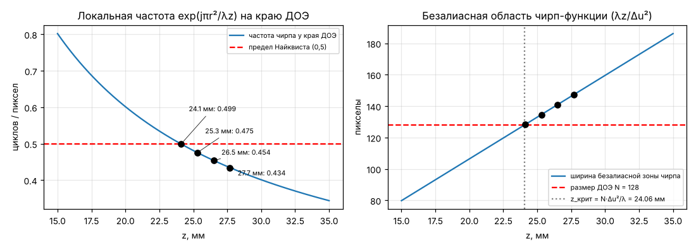
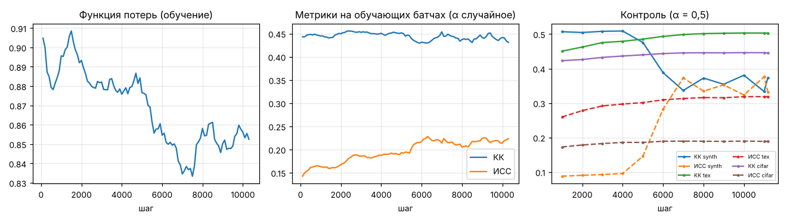
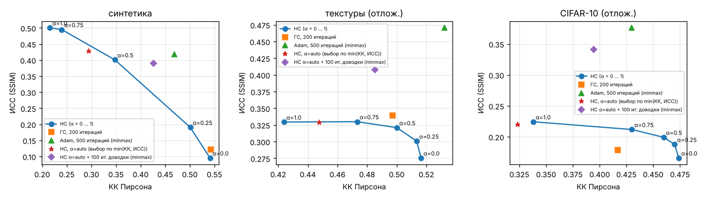
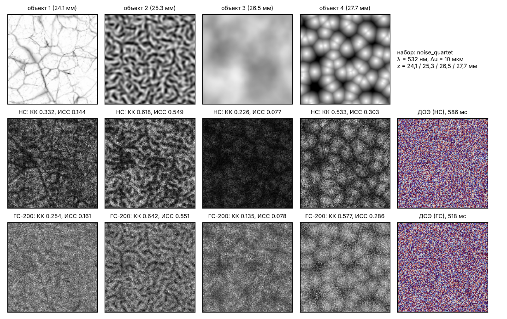
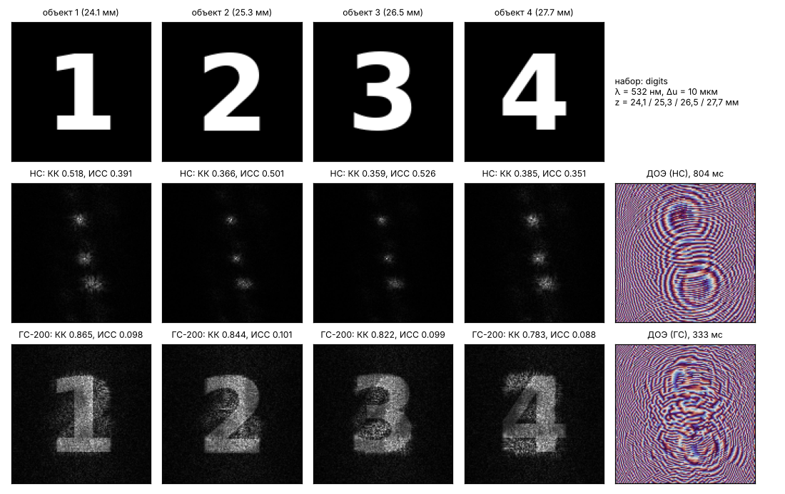
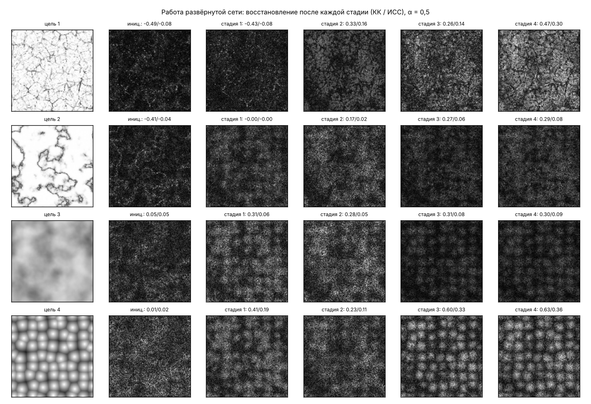

# Отчёт: нейросетевой синтез четырёхплоскостного фазового ДОЭ

Задача: по 4 изображениям 128×128 рассчитать один фазовый ДОЭ 128×128.
Каждое изображение должно восстанавливаться прямым расчётом дифракции Френеля
(одно БПФ) на своём расстоянии: 24,1 / 25,3 / 26,5 / 27,7 мм. Параметры: λ = 532 нм,
пиксел ПВМС 10 мкм. Метрики — КК Пирсона и ИСС (SSIM).

Все числа ниже получены по сохранённым 8-битным PNG: ДОЭ квантуется в 256 уровней,
восстановление делается из квантованного ДОЭ, модуль поля нормируется на максимум.
ИСС — гауссово окно 11×11 (Wang 2004, как MATLAB `ssim`); в `metrics.csv` также есть
`ssim_7x7` (как `skimage` по умолчанию) и глобальная формула со слайда 3.

## Главное

1. **Финальная модель** `weights/doe_net.pt` (вариант g4):
   - физически информированная развёрнутая сеть, 4 стадии, 3,2 млн параметров;
   - каждая стадия получает градиент функции потерь ∂L/∂|F_i|;
   - обучение: 11 000 шагов (~3 ч) на Kaggle GPU T4, без учителя, на смеси синтетики, 700 noise textures и CIFAR-10;
   - синтез — один прямой проход, ~0,15 с на CPU (4 потока).
2. **Чистая сеть** по качеству на уровне Герчберга–Сэкстона (ГС) с 200 итерациями, но в 2 раза быстрее. При этом через вход α она умеет то, чего ГС не умеет: переходить в режим тёмного фона. На символах и фигурах это даёт ИСС 0,44–0,58 против 0,08–0,21 у ГС.
3. **Ваша четвёрка** (Cracks 1 / Gabor 1 / Perlin 1 / Voronoi 1):
   - сеть: КК **0,427**, ИСС **0,268** (по протоколу skimage 7×7 — 0,291);
   - FresnelNet из `main`: 0,311 / 0,219 (7×7);
   - ГС-200: 0,402 / 0,269.
4. **Цель «КК и ИСС ≥ 0,85» в этой физической постановке недостижима ни для одного метода** (раздел 5). Прямая оптимизация фазы без ограничения по времени даёт на 4 плоскостях:

   | Изображения | КК | ИСС |
   |---|---|---|
   | Текстуры | 0,52 | 0,47 |
   | Цифры | 0,70 | 0,65 |
   | Буквы | 0,65 | 0,59 |

   Для одной плоскости тот же расчёт даёт для текстур 0,999 / 0,994. Значит, ограничение — в числе плоскостей, а не в методе.
5. **Лучший практический режим — сеть + 100 итераций доводки** по худшей метрике (1,3 с): на отложенных текстурах 0,485 / 0,408, на CIFAR — 0,394 / 0,341. Чистая оптимизация Adam (500 итераций, 3,9 с) — 0,532 / 0,471.

## 1. Физическая модель и проверка дискретизации

|K_i(x,y)| = |FFT[exp(jφ) · exp(jπ(u²+v²)/λz_i)]|. Шаг сетки в плоскостях восстановления
λz_i/(NΔu): 10,02 / 10,52 / 11,01 / 11,51 мкм.



Проверка условия дискретизации чирп-функций (к ссылке ResearchGate «Aliasing-free area in
pixel units of the chirp functions»):

- **Локальная частота** exp(jπr²/λz) у края ДОЭ равна (N/2)Δu²/(λz):
  0,499 / 0,475 / 0,454 / 0,434 цикла/пиксел, то есть меньше 0,5.
- **Безалиасная область чирпа** λz/Δu² ≥ N = 128 выполняется при
  z ≥ z_крит = NΔu²/λ = **24,06 мм**.

Минимальное расстояние задачи 24,1 мм стоит ровно на этой границе, поэтому формула с одним БПФ
корректна во всех четырёх плоскостях. Выходной чирп в модуль поля не входит.

Для обучения используется точная замена переменных φ = ψ − πr²/(λz_ref) (дечирпирование),
z_ref = 25,83 мм. Тест `tests/test_core.py` сверяет её с прямой формулой задания (расхождение < 1e-4).

## 2. Метод

Развёрнутая сеть: U-Net-инициализатор задаёт фазы в плоскостях изображений. Затем
обратное распространение Френеля и 4 обучаемые стадии. В каждой стадии U-Net получает:
- цели;
- текущие восстановления;
- невязку;
- градиент потерь ∂L/∂|F_i|;
- α.

Стадия выдаёт перевзвешивание амплитуд, маску свободы амплитуды и поправку фазы, после
чего поле возвращается на ДОЭ. Подробности — в [README.md](README.md) и `doe/model.py`.

**Обучение без учителя**:

L = (1−α)(1−КК) + α(1−ИСС) + 0,1·СКО,  α ~ U[0,1].

ИСС считается по восстановлению, нормированному на максимум, то есть так же, как при
сохранении PNG. Добавлен глубокий контроль промежуточных стадий.

**Синтез с `--alpha auto`** (по умолчанию):
- сеть за один батч-проход считает ДОЭ при α = 0; 0,25; 0,5; 0,75; 1;
- по физической модели выбирается ДОЭ с максимальным min(КК, ИСС).

Цели на этапе синтеза известны — это входные изображения, — поэтому выбор честный: ни
оптимизации, ни подгонки результата.

## 3. Данные

| Источник | Доля банка | Использование |
|---|---|---|
| Процедурная синтетика (символы латиницы и кириллицы, фигуры, точки, решётки, 1/f-шум) | 35 % | обучение |
| Ваш пак SBS Noise Textures 128×128 (262 шт., CC0) | 15 % | 226 — обучение, 36 (№ 3 и 7 каждой категории) — контроль |
| Полный пак [700 noise textures](https://opengameart.org/content/700-noise-textures), версия 512×512 | 30 % | фрагменты 128…512 px, то же разбиение |
| CIFAR-10 в оттенках серого (как в [Jemuna/…TensorFlow](https://github.com/Jemuna/Image-Classification-Using-Deep-Learning-in-TensorFlow)) | 20 % | 9000 — обучение, 1000 — контроль; загружен с Kaggle в CSV, без `pickle` |

Банк — 80 000 изображений с аугментацией. Четвёрки собираются случайно.

## 4. Обучение (Kaggle, GPU T4 ×2, по 3 ч)

| Вариант | Стадии | Градиентные признаки | Шагов | Score* | Синтетика | Текстуры | CIFAR |
|---|---|---|---|---|---|---|---|
| u4 | 4 | нет | 12 110 | 0,672 | 0,514 / 0,095 | 0,489 / 0,300 | 0,447 / 0,172 |
| u6 | 6 | нет | 13 039 | 0,667 | 0,518 / 0,097 | 0,477 / 0,293 | 0,445 / 0,172 |
| **g4** | 4 | **да** | 11 000 | **0,722** | 0,333 / 0,376 | **0,503 / 0,319** | 0,446 / 0,189 |
| g6 | 6 | да | 12 000 | 0,688 | 0,520 / 0,101 | 0,492 / 0,314 | 0,444 / 0,194 |
| cpu_s4 (CPU, запас) | 4 | нет | 6 400 | 0,652 | 0,522 / 0,090 | 0,467 / 0,274 | 0,441 / 0,163 |

\* Score — среднее (КК + ИСС) при α = 0,5 по трём контрольным группам (64 четвёрки в каждой).
В ячейках групп — КК / ИСС при α = 0,5.



Около шага 5000 сеть g4 «открыла» режим тёмного фона на разреженных объектах: ИСС на
синтетике вырос с 0,10 до 0,37. Без градиентных признаков (u4, u6) этого не произошло за
всё обучение. Кривые к концу ещё растут, так что сеть не насыщена.

## 5. Цель 0,85 / 0,85: потолок качества

Прямая оптимизация фазы ДОЭ для первых P плоскостей: 3000 итераций Adam, цель — максимум
min(КК, ИСС), лучший из нескольких стартов. Скрипт — `scripts/capacity_experiment.py`,
данные — `results/capacity.json`.

| Набор | 1 плоскость | 2 плоскости | **4 плоскости (задача)** |
|---|---|---|---|
| Ваши текстуры | 0,999 / 0,994 | 0,829 / 0,817 | **0,523 / 0,468** |
| Цифры (старт от ГС) | 0,830 / 0,762 | 0,755 / 0,700 | **0,695 / 0,654** |
| Буквы (старт от ГС) | 0,831 / 0,570 | 0,663 / 0,387 | **0,646 / 0,592** |

Это верхняя оценка для любой сети: сеть тоже выдаёт фазу ДОЭ и не может превзойти
оптимизацию той же фазы. Причины физические:
- плоскости разнесены на 1,2 мм при глубине фокуса λ/NA² ≈ 0,85 мм, поэтому в каждой
  плоскости присутствует расфокусированный свет трёх других изображений;
- один фазовый экран — это 16 384 степени свободы против 4×16 384 требуемых амплитуд.

Для разреженных объектов на чёрном фоне предел ниже 0,85 даже для одной плоскости:
фазовый ДОЭ порождает спекл.

## 6. Сравнение методов (контроль, по 24 четвёрки на группу)

| Метод | Синтетика | Текстуры (отлож.) | CIFAR-10 (отлож.) | Время на ДОЭ, мс |
|---|---|---|---|---|
| НС, α = 0 (макс. КК) | 0,518 / 0,093 | 0,517 / 0,276 | 0,459 / 0,164 | 167 |
| НС, α = 0,5 | 0,351 / 0,376 | 0,502 / 0,317 | 0,445 / 0,197 | 150 |
| НС, α = 1 (макс. ИСС) | 0,167 / 0,504 | 0,423 / 0,327 | 0,320 / 0,219 | 159 |
| НС, α = auto (макс. min) | 0,295 / 0,428 | 0,448 / 0,329 | 0,324 / 0,220 | 568 |
| **НС α = auto + 100 итераций доводки** | 0,426 / 0,390 | 0,485 / 0,408 | 0,394 / 0,341 | 1348 |
| ГС, 50 итераций | 0,532 / 0,114 | 0,461 / 0,305 | 0,388 / 0,158 | 85 |
| ГС, 200 итераций | 0,542 / 0,122 | 0,497 / 0,339 | 0,417 / 0,178 | 319 |
| Adam, 500 итераций (minmax) | 0,468 / 0,418 | 0,532 / 0,471 | 0,430 / 0,376 | 3918 |

В ячейках — КК / ИСС. CPU, 4 потока; время без ввода-вывода. Для α = auto — 5 вариантов α за один батч.



## 7. Контрольные наборы (НС, α = auto, один проход)

| Набор | КК | ИСС | ИСС 7×7 | ГС-200: КК / ИСС |
|---|---|---|---|---|
| Ваша четвёрка* | 0,427 | 0,268 | 0,291 | 0,402 / 0,269 |
| textures_a (отлож.) | 0,396 | 0,219 | 0,237 | 0,322 / 0,201 |
| textures_b (отлож.) | 0,490 | 0,376 | 0,377 | 0,599 / 0,371 |
| textures_c (отлож.) | 0,481 | 0,355 | 0,362 | 0,578 / 0,363 |
| digits | 0,407 | 0,442 | 0,457 | 0,828 / 0,097 |
| letters | 0,264 | 0,584 | 0,623 | 0,823 / 0,084 |
| words | 0,474 | 0,553 | 0,569 | 0,786 / 0,212 |
| shapes | 0,222 | 0,530 | 0,569 | 0,732 / 0,088 |
| natural (`skimage.data`) | 0,393 | 0,274 | 0,273 | 0,512 / 0,251 |

\* Эти четыре текстуры входили в обучающую часть, поэтому для оценки обобщения
смотрите `textures_a/b/c`.

ДОЭ, восстановления, `metrics.csv/json` и `preview.png` для каждого набора лежат в
`results/<набор>/`.





## 8. Сравнение с реализацией в `main` (FresnelNet)

| | `main` (FresnelNet, после дообучения) | Эта ветка (g4) |
|---|---|---|
| Ваша четвёрка, КК / ИСС 7×7 | 0,311 / 0,219 | **0,427 / 0,291** |
| Обучение | CPU, 468 с, width 12 | GPU T4, ~3 ч, 3,2 млн параметров |
| Функция потерь | СКО + многомасштабная + корреляция | (1−α)(1−КК) + α(1−ИСС) + СКО, ИСС по PNG-нормировке |
| Данные | 140 текстур + процедурные фигуры | синтетика + 700 noise textures (512 px) + CIFAR-10 |
| Управление компромиссом КК/ИСС | нет | α и `--alpha auto` |

Из `main` стоит перенять разбиение текстур по семействам, независимую квадратуру
Френеля в тестах и SHA256-манифесты.

## 9. Ограничения и что дальше

- Чистая сеть отстаёт от потолка на ~0,1–0,15 по худшей метрике. Обучение не насыщено:
  на T4 шаг занимал ~0,85 с, потому что конвейер упирается в CPU. Ускорение подготовки
  батчей и более долгое обучение — самый прямой путь к росту качества.
- Разбиение текстур по номерам, а не по семействам: оценка обобщения на новые семейства
  может быть ниже.
- Это численное моделирование: эксперимент на физическом ПВМС не проводился.

## Воспроизведение

```bash
python synthesize.py --input-dir examples/noise_quartet --out results/my_run          # НС, α=auto
python synthesize.py --input-dir examples/noise_quartet --refine 100 --out results/r   # НС + доводка
python scripts/prepare_data.py                                                        # данные для обучения
python scripts/kaggle_run.py push --slug doe-nn-train --dataset fiskarik/doe-nn-data \
    --require-gpu --job "g4:--hours 3 --batch 24 --amp --bank 80000 --grad-feat"
python scripts/make_report.py --weights weights/doe_net.pt --log weights/train_log.jsonl
python scripts/capacity_experiment.py _ d1.png,d2.png,d3.png,d4.png l1.png,l2.png,l3.png,l4.png
```
