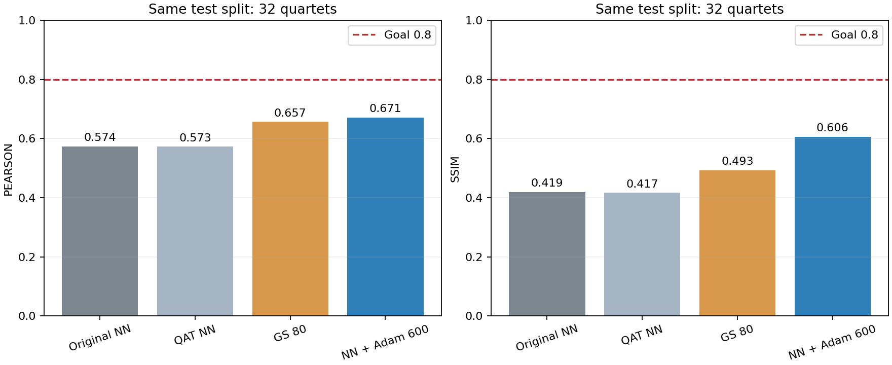
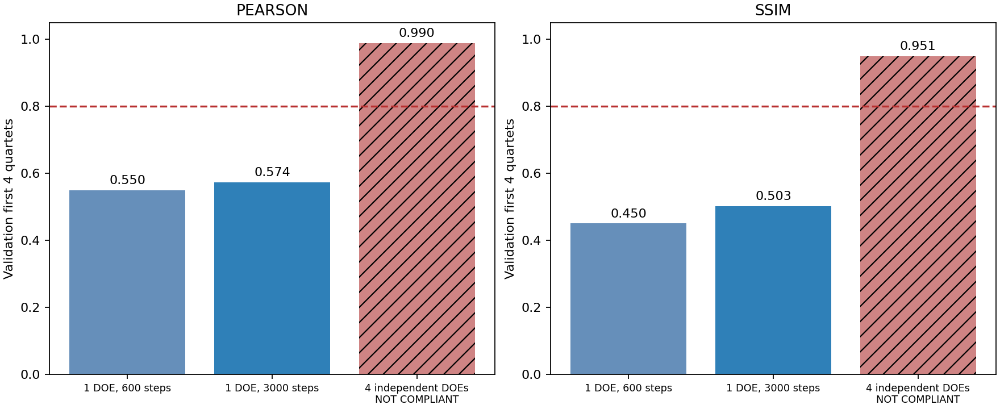
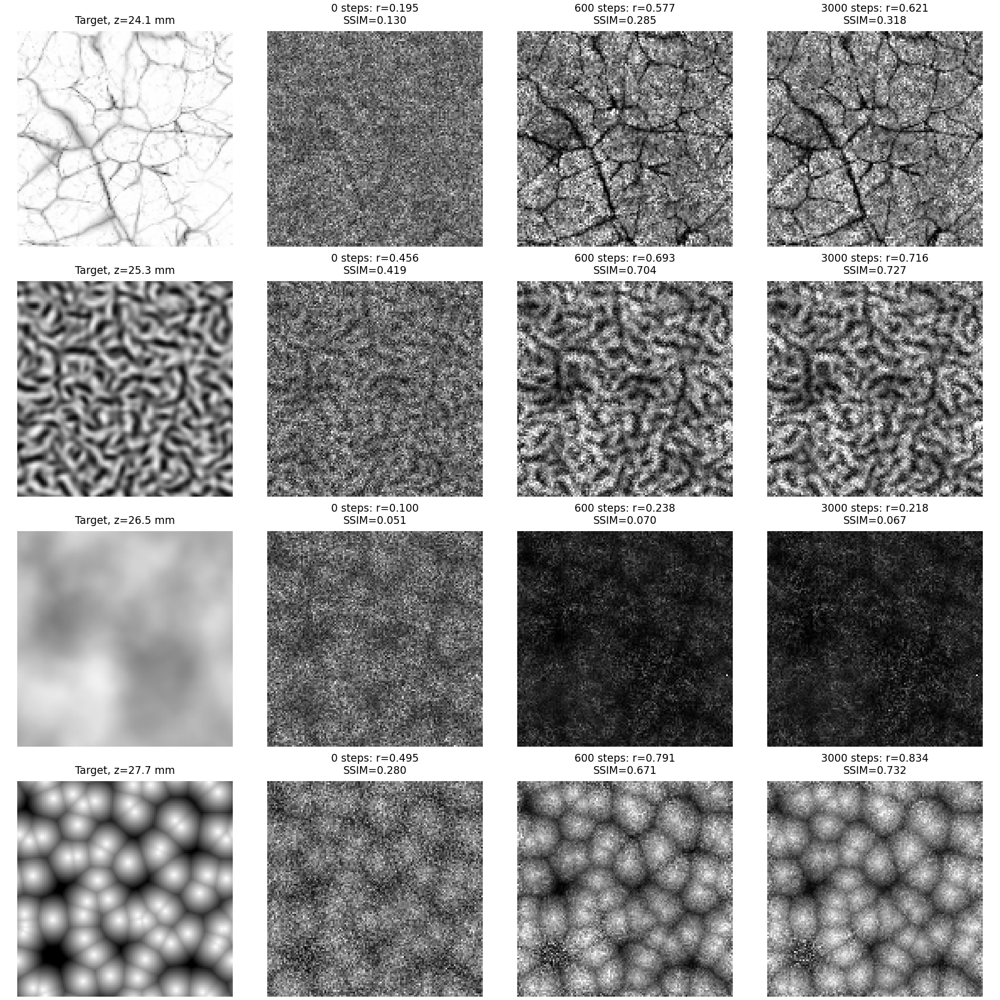

# Исследование цели 0.8 по Pearson и SSIM

**При одном общем ДОЭ цель пока не достигнута.** Это исследование и улучшение
качества, а не заявление о выполнении целевого порога.

## Фактические результаты

| Набор | Метод | Pearson | SSIM | Один общий ДОЭ |
|---|---|---:|---:|---|
| test_32 | original neural | 0.57364 | 0.41853 | да |
| test_32 | QAT neural candidate | 0.57268 | 0.41655 | да |
| test_32 | GS 80 | 0.65675 | 0.49291 | да |
| test_32 | QAT neural + 600 Adam steps | 0.67111 | 0.60637 | да |
| user_quartet | original neural | 0.31135 | 0.21861 | да |
| user_quartet | QAT neural + 0 Adam steps | 0.31144 | 0.21986 | да |
| user_quartet | QAT neural + 600 Adam steps | 0.57500 | 0.43222 | да |
| user_quartet | QAT neural + 3000 Adam steps | 0.59732 | 0.46088 | да |
| validation_first_4 | validation_chirp1_600 | 0.52616 | 0.45939 | да |
| validation_first_4 | validation_chirp3_600 | 0.55496 | 0.46096 | да |
| validation_first_4 | validation_chirp3_lbfgs | 0.54306 | 0.43619 | да |
| validation_first_4 | validation_independent_planes_600 | 0.98968 | 0.95072 | **нет — контроль** |
| validation_first_4 | validation_neural_3000 | 0.57363 | 0.50267 | да |
| validation_first_4 | validation_perceptual_600 | 0.55028 | 0.45044 | да |
| validation_first_4 | validation_physics_600 | 0.53670 | 0.34401 | да |

## Что изменено

- Добавлен дифференцируемый SSIM, проверенный против skimage и конечными разностями.
- Добавлено обучение с прямым perceptual loss и straight-through квантованием в 8 бит.
  12 эпох QAT дали лишь малое улучшение validation loss; на test обе метрики чистой
  сети немного снизились. Поэтому прежние production-веса не заменены.
- Проверены Adam, LBFGS, разные chirp-инициализации, 600 и 3000 шагов фазы.
- Добавлен опциональный `--refine-steps`: сеть плюс итеративный решатель одной общей
  фазы. Это работает медленнее одного forward pass; число шагов и время явно записаны.
- В контрольном опыте каждому изображению разрешён свой отдельный ДОЭ.
  Высокие 0.99/0.95 относятся к этой другой постановке, не к выполнению задания.

## Корректность сравнения

Физика Френеля, λ, расстояния и размер 128×128 не менялись. Сохраняется амплитуда,
не интенсивность. Все финальные метрики считают фактические реконструкции из
сохранённого 8-битного PNG ДОЭ; нет фильтрации, подгонки gain по target или ROI.
Настройки выбирались по validation, после чего выполнена оценка на тех же 32 test
четвёрках. Для исследовательского подбора использованы первые 4 validation-четвёрки,
поэтому эти малые оценки не являются новым независимым test.
Результаты с разными split нельзя сравнивать как показатели одной выборки.
Итеративный solver использует желаемые изображения как входы обратной задачи;
его качество не выдаётся за качество чистой нейросети. Времена — текущий CPU,
batched throughput, без статистических гарантий. Опыты не доказывают математической
невозможности 0.8 с одним ДОЭ.

## Следующие направления

1. Более мощный обучаемый инициализатор волнового фронта (U-Net/HoloNet),
   пространственные маски амплитудной свободы и больше обучаемых optical stages.
   Это перспективные изменения архитектуры, **не проверенное обещание 0.8**.
2. Teacher/student дистилляция итеративного решателя. Сначала учитель должен
   показать нужное качество: текущие результаты сами по себе 0.8 не обеспечивают.
3. При разрешённом изменении задания — отдельные ДОЭ/экспозиции или больше
   управляемых пикселей. Четыре независимых ДОЭ показали высокий результат в
   контрольном опыте, но исходное условие одного ДОЭ при этом нарушается.

Источники: [Neural Holography](https://github.com/computational-imaging/neural-holography)
и [Tensor Holography](https://github.com/liangs111/tensor_holography). Прочитаны
официальные README и опубликованный алгоритм SGD. Их оценки не переносились на
нашу постановку, код/веса не копировались. Дополнительные источники и исходные
истории находятся в `docs/quality-research.md` и каталоге probes архива.

Проверки: **17 тестов pytest**. Полные CPU-обучение и benchmark выполнены.
Kaggle/GPU и эксперимент на физическом ПВМС не выполнялись.
