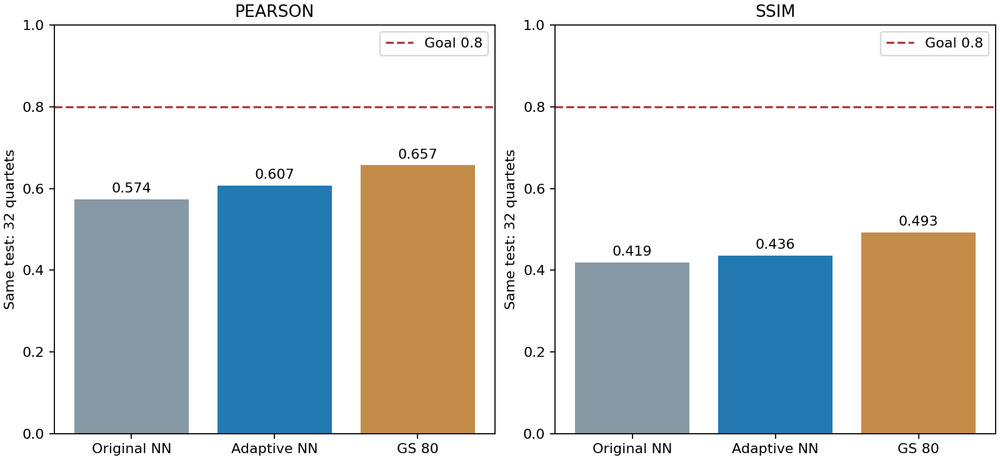
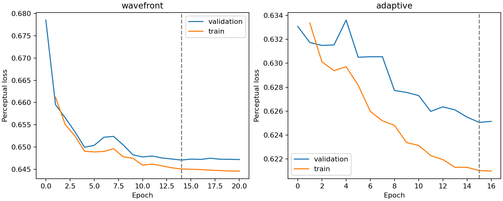
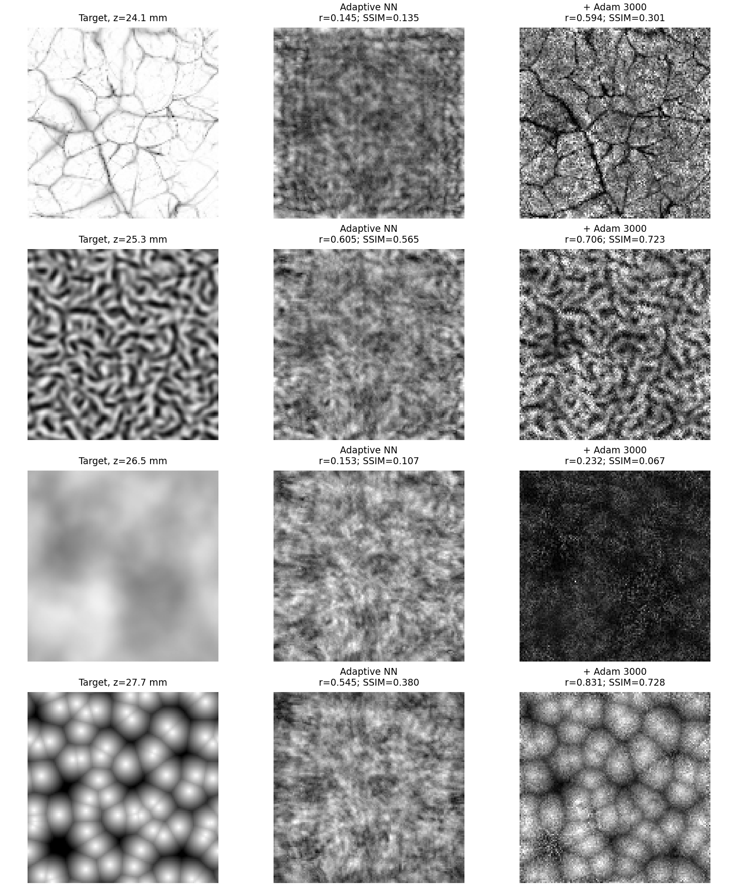

# Adaptive wavefront: результаты обучения

**Pearson ≥0.8 и SSIM ≥0.8 одновременно пока не достигнуты.**
Новая чистая сеть на том же test из 32 четвёрок: **0.60747 / 0.43629**.
Прежняя сеть в том же измерении: 0.57364 / 0.41852.
Прибавка: +0.03383 Pearson и +0.01777 SSIM.
GS80 здесь качественнее обеих сетей; порог 0.8 также не достигнут.

## Что обучено

1. Wavefront U-Net: 20 эпох, 6 оптических слоёв, инициализатор ширины 8 с тремя
   уровнями. Старт из прежних texture-весов, perceptual loss с 8-битным STE.
   Validation loss 0.678545 → 0.647054,
   лучшая эпоха 14; CPU 470.1 с.
2. Adaptive: 16 эпох, 12 оптических слоёв, U-Net с четырьмя уровнями и обучаемая
   пространственная амплитудная свобода/фазовая поправка каждого слоя. Модуль
   итогового единственного ДОЭ всегда единица. Старт из выбранного wavefront checkpoint.
   Validation loss 0.633084 → 0.625057,
   лучшая эпоха 15; CPU 1078.2 с.

Обучение использовало прежние 256 train-четвёрок, validation — 32. Семейства
train/validation/test различны; Cracks/Gabor/Perlin/Voronoi зарезервированы.
Checkpoint выбирался по validation loss. Test не использовался в loss,
оптимизации весов или выборе эпохи. Повторные исследовательские сравнения на
одном test означают, что его нельзя считать новым, ранее не виденным аудитом.
Для итогового подтверждения новой архитектуры нужен дополнительный независимый набор.
На CPU, 1 поток, batch=4: исходная сеть 0.0325,
adaptive 0.1517, GS80 0.2032 с/четвёрку.
Это время синтеза в пакете, без IO и расчёта метрик; новая сеть тяжелее прежней.

## Выбранные пользовательские изображения

Adaptive без оптимизатора: 0.36223/0.29678.
С 3000 шагами общей фазы: 0.59091/0.45464.
Последний результат хуже опубликованного v2 QAT + 3000: 0.59732/0.46088.
Поэтому v2 сохранён, новый гибрид не объявлен улучшением.
Лучший опубликованный test-гибрид v2 + 600 остаётся 0.67111/0.60637;
его нельзя напрямую сопоставлять со скоростью одного forward pass.

## Журнал дополнительных попыток

| Набор | Метод | Pearson | SSIM | Сетка |
|---|---|---:|---:|---|
| test_32 | baseline | 0.57364 | 0.41852 | original |
| test_32 | adaptive | 0.60747 | 0.43629 | original |
| test_32 | gs_80 | 0.65675 | 0.49291 | original |
| reserved_user_quartet | adaptive + 0 phase Adam steps | 0.36223 | 0.29678 | original |
| reserved_user_quartet | adaptive + 3000 phase Adam steps | 0.59091 | 0.45464 | original |
| validation_first_4 | progressive_direct | 0.50678 | 0.47927 | original |
| validation_first_4 | progressive_fitwarm | 0.50073 | 0.48400 | original |
| validation_first_4 | raar_085 | 0.56060 | 0.47824 | original |
| validation_first_4 | raar_095 | 0.56060 | 0.47824 | original |
| validation_first_4 | homotopy_geometry | 0.54264 | 0.43674 | original |
| validation_first_4 | homotopy_targets | 0.55107 | 0.47064 | original |
| validation_first_4 | robust_from_expert | 0.57204 | 0.48632 | original |
| validation_first_4 | softpeak_from_expert | 0.58002 | 0.51400 | original |
| validation_first_1_fitted_diagnostic | target-specific neural weights; NOT generalization | 0.39594 | 0.42967 | original |
| validation_first_4 | camera_pad2 | 0.65749 | 0.49429 | declared finer camera, padding=2 |
| validation_first_4 | camera_pad2_flat | 0.65811 | 0.49845 | declared finer camera, padding=2 |
| validation_first_4 | camera_pad3 | 0.67807 | 0.49565 | declared finer camera, padding=3 |
| validation_first_4 | camera_pad3_minimum | 0.67458 | 0.49967 | declared finer camera, padding=3 |
| validation_first_4 | camera_pad4 | 0.68441 | 0.50133 | declared finer camera, padding=4 |

Progressive phase, RAAR, homotopy и новые loss использовали первые 4 validation-четвёрки.
Robust/softpeak продолжают прежние 3000 шагов ещё на 1800; это больше вычислений.
RAAR при обоих beta вернулся к одной сохранённой лучшей инициализации.
Target-specific neural fitting меняет веса на одном входе: это диагностика, не
обобщение сети. Параметры опытов, история и итоговые фазы лежат в `../probes`.

## Отдельное исследование сетки камеры

В приложенном ТЗ указан шаг ПВМС, но не физический шаг камеры. Проверена явно
заданная более частая сетка: нулевое дополнение **до** единственного FFT,
затем центральные 128×128 отсчётов. Управляемый ДОЭ всё ещё 128×128; оцениваются
все 128×128 пикселей каждого исходного target. Выходной шаг и физическое поле
зрения меняются относительно прежней сетки λz/(128Δu). Эти результаты **не являются
улучшением модели при прежней дискретизации**, не включены в основной benchmark
и не используются в production-инференсе. Учтена также энергия вне камеры.
Подгонка gain применялась только внутри MRAF-инициализации; конечная оценка
использует прежнюю нормировку модуля по собственному максимуму без target gain.
Ни одна проверенная сетка не дала оба показателя 0.8.

## Следующий GPU-эксперимент

Готов приватный Kaggle job: 24 оптических слоя, 4 уровня U-Net, 80 эпох,
2048 train-четвёрок, те же 32 validation и 32 test. Исходные train-текстуры прежние:
увеличено число комбинаций и аугментаций, не число независимых источников.
Notebook самодостаточен и не требует Интернета внутри Kaggle. Целиком выполнены
6 ячеек локального quick-прогона; это проверка интеграции, не GPU-обучение.
Удалённый запуск **не отправлен**: нет KAGGLE_API_TOKEN в секретах и применённого
доступа к api.kaggle.com/www.kaggle.com. Подготовленные metadata и инструкции
в `../kaggle`; скрипт подготовки `scripts/stage_kaggle_job.py`.
Больший запуск не гарантирует 0.8. После него требуются фактические метрики.

## Протокол и проверки

Один общий фазовый ДОЭ, λ=532 нм, шаг ПВМС 10 мкм, z=24.1/25.3/26.5/27.7 мм.
Для основной таблицы физика и выходные сетки прежние. Оценка по реальным
8-битным реконструкциям из квантованной фазы, SSIM skimage с окном 7 и
data_range=1, Pearson по всем пикселям. Нет фильтрации и подмены входных изображений.
26 тестов прошли, включая прямую квадратуру Fresnel, сопряжённость и энергию
camera-модели, градиенты нового инициализатора и checkpoint round trip.
Физический ПВМС не проверялся. Неудачные опыты не доказывают невозможность 0.8.
