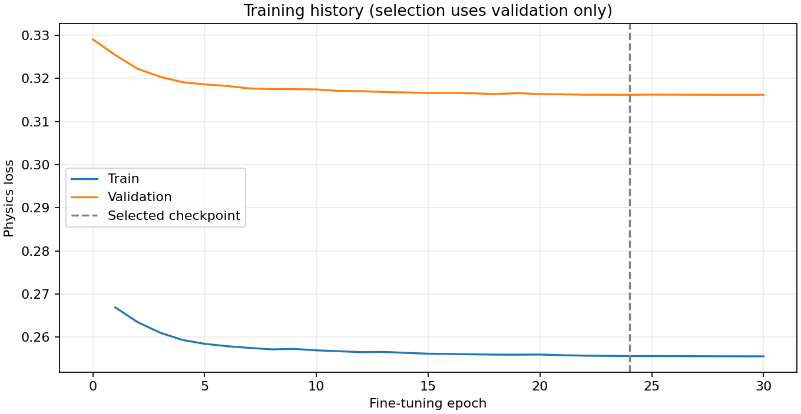
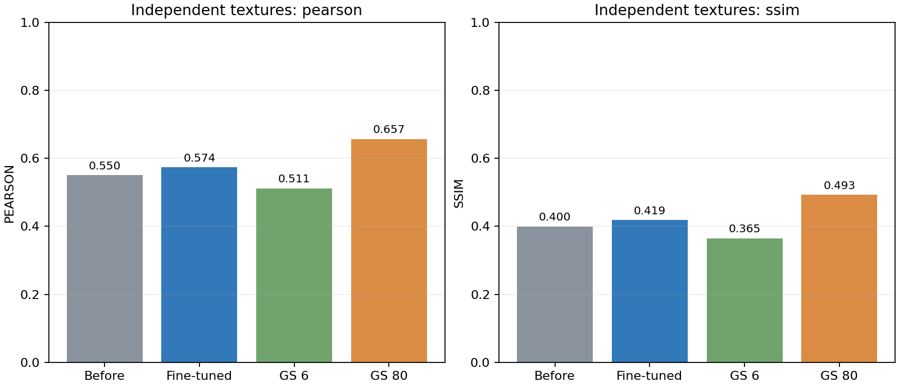
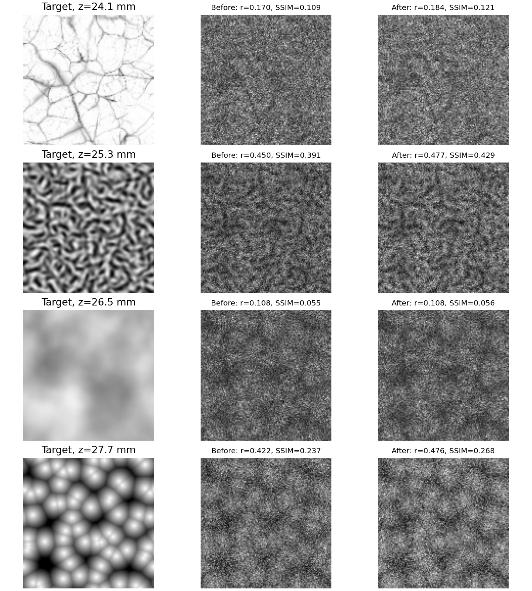

# Отчёт по дообучению на текстурах

Реальное дообучение весов исходной модели, а не обучение новой сети с нуля.
Устройство: **cpu**. Эпох: 30; выбран checkpoint
эпохи **24** по минимуму validation loss. Adam запущен с новой
историей оптимизатора. Время обучения: 468.3 с.

Validation loss: **0.329082 → 0.316214**.

## Данные и отсутствие утечки

Использован предоставленный ZIP: **262** текстуры 128×128, а не полный набор из 700.
Обучение: 140 исходных изображений;
validation: 28; test: 28;
резервные семейства: 66.
Составлено 256/32/32
четвёрок. Семейства между split не пересекаются, проверены дубликаты пикселей.
Cracks/Gabor/Perlin/Voronoi полностью исключены из обучения и выбора checkpoint.
Train-аугментации: повороты на 90°, отражение, циклические сдвиги; все записаны в manifest.

## Результаты до и после

Одна и та же независимая выборка: **32 четвёрки**.
Одинаковые входы, оптическая модель, 8-битное квантование ДОЭ и амплитуд.
Выбранная пользовательская четвёрка не участвовала в обучении.

| Набор/плоскость | Pearson до | После | SSIM до | После |
|---|---:|---:|---:|---:|
| independent_test_mean | 0.55026 | 0.57364 | 0.39950 | 0.41853 |
| reserved_user_quartet_mean | 0.28755 | 0.31135 | 0.19807 | 0.21861 |
| reserved_z_24.1_mm | 0.17021 | 0.18424 | 0.10950 | 0.12106 |
| reserved_z_25.3_mm | 0.45041 | 0.47699 | 0.39057 | 0.42868 |
| reserved_z_26.5_mm | 0.10769 | 0.10789 | 0.05535 | 0.05623 |
| reserved_z_27.7_mm | 0.42188 | 0.47629 | 0.23688 | 0.26844 |

## Физика, метрики и ограничения

λ=532 нм, входной шаг 10 мкм, 128×128, z=24.1/25.3/26.5/27.7 мм.
Один FFT на плоскость, сохраняется модуль поля, а не интенсивность.
Все реконструкции рассчитаны из сохранённого квантованного ДОЭ.
PNG каждой плоскости масштабирован по собственному максимуму без подгонки по target.
Pearson и локальный SSIM (окно 7×7) рассчитаны по фактическим PNG.
Время benchmark — batched throughput после прогрева, не статистическая оценка latency.
Повторяющиеся исходные изображения в разных тестовых четвёрках не считаются
независимыми новыми источниками: это 28 исходников из двух семейств, не 128 уникальных.
Высокое качество и преимущество над GS не гарантируются; сравнение показывает
фактическое изменение, включая ухудшения. Оптический эксперимент не проводился.

## Указанные пользователем ссылки

- [TensorFlow README](https://github.com/Jemuna/Image-Classification-Using-Deep-Learning-in-TensorFlow):
  прочитан; это описание классификации CIFAR-10, не набор голограмм. Код модели и
  данные CIFAR-10 не копировались и не использовались для этого дообучения.
- [OpenGameArt](https://opengameart.org/content/700-noise-textures):
  доступ из среды заблокирован сетевой политикой; использован только загруженный
  пользователем ZIP с 262 текстурами. Полный набор из 700 не скачивался.
- [ResearchGate](https://www.researchgate.net/figure/Aliasing-free-area-in-pixel-units-of-the-chirp-functions-under-the-calculation-condition_fig5_236235124):
  страница недоступна по сетевой политике, её содержимое не проверено.
  В код независимо добавлена диагностика частоты обеих квадратичных chirp-функций.
  Входная chirp проходит консервативную проверку Nyquist; выходная требует
  осторожности при интерполяции комплексной фазы. Она является поточечным множителем
  единичного модуля и не меняет сохраняемую амплитуду. Полная aliasing-free
  дискретизация обеих chirp-функций не заявляется.

Удалённый запуск в Kaggle не выполнен: в среде нет настроенной авторизации.
Лицензия входящего ZIP указана в его License.txt как CC0/Public Domain.

SHA256 до: `fc26df106b0be3ca488c4cc4b2e3ee00cc70f69060da0973dc4fbc10297d6878`.

SHA256 после: `eff566a2287f30fdad029eda903967e6674bcdb330d2ca433e2aabf2a39c32ad`.
