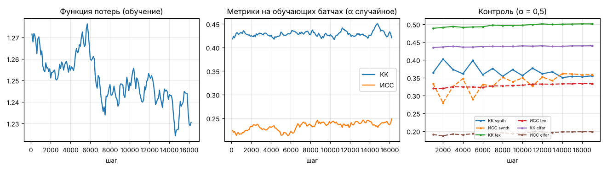
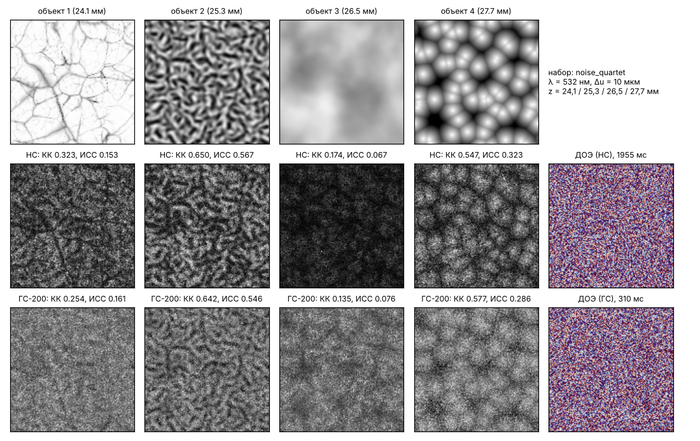

# Отчёт: нейросетевой синтез четырёхплоскостного фазового ДОЭ

Задача: по 4 изображениям 128×128 рассчитать один фазовый ДОЭ 128×128.
Каждое изображение должно восстанавливаться прямым расчётом дифракции Френеля
(одно БПФ) на своём расстоянии: 24,1 / 25,3 / 26,5 / 27,7 мм. Параметры: λ = 532 нм,
пиксел ПВМС 10 мкм. Метрики — КК Пирсона и ИСС (SSIM).

**Правило сравнения** (ответ эксперта в чате хакатона, 06.11): сравниваются амплитуды |K|;
каждое изображение — и исходное, и восстановленное — перед сравнением нормируется на
максимум. Все числа ниже посчитаны по этому правилу и по сохранённым 8-битным PNG:
ДОЭ квантуется в 256 уровней, восстановление делается из квантованного ДОЭ.
ИСС — гауссово окно 11×11 (как MATLAB `ssim`). В `metrics.csv` есть также ИСС 7×7
(как `skimage`) и глобальная формула со слайда 3.

## Главное

1. **Финальная модель** `weights/doe_net.pt` (вариант ftmm):
   - физически информированная развёрнутая сеть, 4 стадии, 3,2 млн параметров, на входе стадий — градиент функции потерь;
   - обучение: 11 000 шагов (g4) плюс 17 000 шагов дообучения на Kaggle GPU T4 (всего ~7 ч);
   - функция потерь — с членом, тянущим вверх худшую из двух метрик;
   - синтез — один прямой проход, ~0,12 с при фиксированном α или ~0,45 с с `--alpha auto` (CPU, 4 потока).
2. **Чистая сеть с `--alpha auto`:**

   | Набор | КК | ИСС | ГС-200 для сравнения |
   |---|---|---|---|
   | Отложенные текстуры | 0,456 | 0,334 | 0,497 / 0,335 |
   | Цифры | 0,621 | 0,511 | 0,828 / 0,097 |
   | Слова | 0,569 | 0,548 | 0,786 / 0,212 |
   | Ваша четвёрка | 0,423 | 0,277 | 0,402 / 0,267 |

   На текстурах сеть по ИСС на уровне ГС-200, но в 2 раза быстрее. На разреженных объектах она держит обе метрики, а ГС проваливает ИСС.
3. **Сеть + 100 итераций доводки** (1,3 с): текстуры 0,483 / 0,398, синтетика 0,428 / 0,423, CIFAR 0,385 / 0,327. Чистая оптимизация Adam (500 итераций, 3,7 с) — 0,528 / 0,462 на текстурах.
4. **Цель «КК и ИСС ≥ 0,85» в этой постановке физически недостижима** (раздел 5). Прямая оптимизация фазы без ограничения по времени на 4 плоскостях даёт не больше:

   | Изображения | КК | ИСС |
   |---|---|---|
   | Текстуры | 0,52 | 0,47 |
   | Цифры | 0,70 | 0,65 |

## 1. Физическая модель и проверка дискретизации

|K_i(x,y)| = |FFT[exp(jφ) · exp(jπ(u²+v²)/λz_i)]|. Шаг сетки в плоскостях восстановления
λz_i/(NΔu): 10,02 / 10,52 / 11,01 / 11,51 мкм.


Проверка условия дискретизации чирп-функций (к ссылке ResearchGate «Aliasing-free area in
pixel units of the chirp functions»):

- **Локальная частота** exp(jπr²/λz) у края ДОЭ равна (N/2)Δu²/(λz):
  0,499 / 0,475 / 0,454 / 0,434 цикла/пиксел, то есть меньше 0,5.
- **Безалиасная область чирпа** λz/Δu² ≥ N = 128 выполняется при
  z ≥ z_крит = NΔu²/λ = **24,06 мм**.

Минимальное расстояние задачи 24,1 мм стоит ровно на этой границе, поэтому формула с одним БПФ
корректна во всех четырёх плоскостях.

Физика сверена с независимой реализацией: ДОЭ из присланных `expert_runs`, восстановленные
нашей моделью, совпадают с их полями с корреляцией 0,99999999998.

## 2. Метод

Развёрнутая сеть: U-Net-инициализатор задаёт фазы в плоскостях изображений. Затем
обратное распространение Френеля и 4 обучаемые стадии. В каждой стадии U-Net получает:
- цели;
- текущие восстановления;
- невязку;
- градиент потерь ∂L/∂|F_i|;
- α.

Стадия выдаёт перевзвешивание амплитуд, маску свободы амплитуды и поправку фазы, после
чего поле возвращается на ДОЭ. Подробности — в [README.md](README.md) и `doe/model.py`.

**Обучение без учителя**:

L = (1−α)(1−КК) + α(1−ИСС) + 0,1·СКО + 0,5·(1 − softmin(КК, ИСС)),  α ~ U[0,1].

ИСС считается так же, как его посчитает жюри: оба изображения нормируются на максимум.

**Синтез с `--alpha auto`**:
- сеть за один батч-проход считает ДОЭ при α = 0; 0,25; 0,5; 0,75; 1;
- по физической модели выбирается ДОЭ с максимальным min(КК, ИСС) (`--select min`) или с максимальной суммой (`--select sum`).

Цели на этапе синтеза известны — это входные изображения, — поэтому выбор честный: ни
оптимизации, ни подгонки результата.

## 3. Данные

| Источник | Доля банка | Использование |
|---|---|---|
| Процедурная синтетика (символы латиницы и кириллицы, фигуры, точки, решётки, 1/f-шум) | 35 % | обучение |
| Ваш пак SBS Noise Textures 128×128 (262 шт., CC0) | 15 % | 226 — обучение, 36 (№ 3 и 7 каждой категории) — контроль |
| Полный пак [700 noise textures](https://opengameart.org/content/700-noise-textures), версия 512×512 | 30 % | фрагменты 128…512 px, то же разбиение |
| CIFAR-10 в оттенках серого (как в [Jemuna/…TensorFlow](https://github.com/Jemuna/Image-Classification-Using-Deep-Learning-in-TensorFlow)) | 20 % | 9000 — обучение, 1000 — контроль; загружен с Kaggle в CSV, без `pickle` |

Эксперт подтвердил, что можно использовать любой открытый датасет.

## 4. Обучение (Kaggle, GPU T4 ×2)

**Этап 1 — с нуля, 3 ч** (контроль при α = 0,5, КК / ИСС):

| Вариант | Стадии | Градиентные признаки | Шагов | Score* | Синтетика | Текстуры | CIFAR |
|---|---|---|---|---|---|---|---|
| u4 | 4 | нет | 12 110 | 0,672 | 0,514 / 0,095 | 0,489 / 0,300 | 0,447 / 0,172 |
| u6 | 6 | нет | 13 039 | 0,667 | 0,518 / 0,097 | 0,477 / 0,293 | 0,445 / 0,172 |
| **g4** | 4 | **да** | 11 000 | **0,722** | 0,333 / 0,376 | 0,503 / 0,319 | 0,446 / 0,189 |
| g6 | 6 | да | 12 000 | 0,688 | 0,520 / 0,101 | 0,492 / 0,314 | 0,444 / 0,194 |

\* Score — среднее (КК + ИСС) при α = 0,5 по трём контрольным группам.

**Этап 2 — дообучение от g4, ≤ 5 ч (лимит по времени на Kaggle).** Банк — 120 000 изображений.
Сравнение по официальному правилу, `--alpha auto`, 24 четвёрки на группу и 56 кейсов экспертов
(`results/model_comparison.json`):

| Модель | Функция потерь | Шагов | Текстуры | CIFAR | Кейсы экспертов | min-score | sum-score |
|---|---|---|---|---|---|---|---|
| g4 | max | 11 000 | 0,443 / 0,319 | 0,322 / 0,209 | 0,396 / 0,292 | 0,273 | 0,660 |
| ft | max | +17 003 | 0,446 / 0,333 | 0,323 / 0,218 | 0,403 / 0,303 | 0,285 | 0,676 |
| **ftmm** | max + softmin | +17 020 | **0,456 / 0,334** | 0,324 / 0,217 | **0,414 / 0,302** | 0,284 | **0,682** |
| rms | rms | +14 222 | 0,473 / 0,294 | 0,387 / 0,201 | 0,443 / 0,262 | 0,253 | 0,687 |
| rms_mm | rms + softmin | +13 957 | 0,471 / 0,289 | 0,381 / 0,200 | 0,445 / 0,260 | 0,250 | 0,682 |

Выбрана ftmm. Варианты под RMS-нормировку (см. раздел 8) по официальному правилу
дают выше КК, но ниже ИСС.



**Узкое место обучения.** Профилировщик на T4: ~60 % времени GPU уходит на копирования и
поэлементные операции (круговой паддинг свёрток, перестановки формата для fp16), свёртки —
~13 %. Шаг занимает ~0,87 с. Замена кругового паддинга и формат `channels_last` должны дать
кратное ускорение, то есть больше шагов за те же часы.

## 5. Цель 0,85 / 0,85: потолок качества

Прямая оптимизация фазы ДОЭ для первых P плоскостей: 3000 итераций Adam, цель — максимум
min(КК, ИСС), лучший из нескольких стартов. Скрипт — `scripts/capacity_experiment.py`,
данные — `results/capacity.json`.

| Набор | 1 плоскость | 2 плоскости | **4 плоскости (задача)** |
|---|---|---|---|
| Ваши текстуры | 0,999 / 0,994 | 0,829 / 0,817 | **0,523 / 0,468** |
| Цифры (старт от ГС) | 0,830 / 0,762 | 0,755 / 0,700 | **0,695 / 0,654** |
| Буквы (старт от ГС) | 0,831 / 0,570 | 0,663 / 0,387 | **0,646 / 0,592** |

Это верхняя оценка для любой сети: сеть тоже выдаёт фазу ДОЭ и не может превзойти
оптимизацию той же фазы. Причины физические:
- плоскости разнесены на 1,2 мм при глубине фокуса λ/NA² ≈ 0,85 мм, поэтому в каждой
  плоскости присутствует расфокусированный свет трёх других изображений;
- один фазовый экран — это 16 384 степени свободы против 4×16 384 требуемых амплитуд.

## 6. Сравнение методов (контроль, по 24 четвёрки на группу)

| Метод | Синтетика | Текстуры (отлож.) | CIFAR-10 (отлож.) | Время на ДОЭ, мс |
|---|---|---|---|---|
| НС, α = 0 (макс. КК) | 0,514 / 0,114 | 0,519 / 0,290 | 0,458 / 0,164 | 123 |
| НС, α = 0,5 | 0,368 / 0,356 | 0,501 / 0,320 | 0,438 / 0,196 | 123 |
| НС, α = 1 (макс. ИСС) | 0,203 / 0,505 | 0,433 / 0,331 | 0,321 / 0,217 | 118 |
| НС, α = auto (макс. min) | 0,331 / 0,362 | 0,456 / 0,334 | 0,324 / 0,217 | 436 |
| **НС α = auto + 100 итераций доводки** | 0,428 / 0,423 | 0,483 / 0,398 | 0,385 / 0,327 | 1328 |
| ГС, 50 итераций | 0,532 / 0,112 | 0,461 / 0,303 | 0,388 / 0,156 | 72 |
| ГС, 200 итераций | 0,542 / 0,120 | 0,497 / 0,335 | 0,417 / 0,176 | 277 |
| Adam, 500 итераций (minmax) | 0,468 / 0,418 | 0,528 / 0,462 | 0,419 / 0,358 | 3698 |

В ячейках — КК / ИСС. CPU, 4 потока; время без ввода-вывода.


## 7. Контрольные наборы (НС, α = auto, один проход)

| Набор | КК | ИСС | ИСС 7×7 | ГС-200: КК / ИСС |
|---|---|---|---|---|
| Ваша четвёрка* | 0,423 | 0,277 | 0,299 | 0,402 / 0,267 |
| textures_a (отлож.) | 0,344 | 0,229 | 0,243 | 0,322 / 0,200 |
| textures_b (отлож.) | 0,493 | 0,395 | 0,394 | 0,599 / 0,422 |
| textures_c (отлож.) | 0,480 | 0,348 | 0,352 | 0,578 / 0,350 |
| digits | 0,621 | 0,511 | 0,529 | 0,828 / 0,097 |
| letters | 0,598 | 0,340 | 0,355 | 0,823 / 0,084 |
| words | 0,569 | 0,548 | 0,563 | 0,786 / 0,212 |
| shapes | 0,483 | 0,339 | 0,359 | 0,732 / 0,088 |
| natural (`skimage.data`) | 0,394 | 0,271 | 0,270 | 0,512 / 0,247 |

\* Эти четыре текстуры входили в обучающую часть, поэтому для оценки обобщения
смотрите `textures_a/b/c`.

ДОЭ, восстановления, `metrics.csv/json` и `preview.png` для каждого набора лежат в
`results/<набор>/`.




## 8. Присланные `expert_runs`: проверка

- **56 кейсов** — текстуры семейств Streak, Perlin, Milky, Turbulence.
- **Метрики честные:** пересчёт по их PNG совпал.
- **Физика та же:** корреляция полей 0,99999999998.
- **Но нормировка другая:** RMS восстановления приравнен RMS цели, с насыщением на 255 (`--norm rms` воспроизводит их PNG с точностью ±1).

| Решения на тех же 56 кейсах | По их правилу (rms) | По официальному правилу (max) |
|---|---|---|
| Их ДОЭ | 0,682 / 0,451 | 0,571 / 0,254 |
| Наша НС (ftmm, α = auto) | — | 0,414 / 0,302 |

При правиле RMS горячие спекл-пики насыщаются, а ИСС и КК растут. По официальному правилу
(нормировка на максимум) их ДОЭ дают ИСС 0,254, у нашей сети — 0,302; по КК их решения выше.
Поддержка правила RMS в коде оставлена (`--norm rms`, `--ssim-norm rms`) на случай, если
организаторы его примут.

## 9. Сравнение с реализацией FresnelNet в `main`

| | FresnelNet (после дообучения) | `unrolled/` (ftmm) |
|---|---|---|
| Ваша четвёрка, КК / ИСС 7×7 | 0,311 / 0,219 | **0,423 / 0,299** |
| Обучение | CPU, 468 с, width 12 | GPU T4, ~7 ч, 3,2 млн параметров |
| Данные | 140 текстур + процедурные фигуры | синтетика + 700 noise textures (512 px) + CIFAR-10 |
| Управление компромиссом КК/ИСС | нет | α, `--alpha auto`, `--select min/sum` |

Из `main` стоит перенять разбиение текстур по семействам, независимую квадратуру
Френеля в тестах и SHA256-манифесты.

## 10. Ограничения и что дальше

1. **Ускорить обучение** (паддинг, `channels_last`) и обучать дольше: дообучение ещё давало прирост.
2. **Если допустимы 1–2 с на ДОЭ**, использовать режим «сеть + доводка» (`--refine 100`): +0,06 к ИСС на текстурах.
3. **Узнать у организаторов** способ объединения КК и ИСС в итоговую оценку и окно SSIM, затем выставить `--select` и окно в функции потерь.
4. **Разбиение текстур по номерам, а не по семействам:** оценка обобщения на новые семейства может быть ниже.
5. **Это численное моделирование:** эксперимент на физическом ПВМС не проводился.

## Воспроизведение

```bash
cd unrolled
python synthesize.py --input-dir examples/noise_quartet --out results/my_run           # НС, α=auto
python synthesize.py --input-dir examples/noise_quartet --refine 100 --out results/r    # НС + доводка
python scripts/compare_models.py --weights ftmm=weights/doe_net.pt g4=weights/doe_net_g4.pt
python scripts/make_report.py --weights weights/doe_net.pt --log weights/train_log.jsonl
python scripts/kaggle_run.py push --slug doe-nn-ft --dataset fiskarik/doe-nn-data --require-gpu --timeout 18000 \
    --job "ftmm:--init weights/doe_net_g4.pt --grad-feat --hours 4.5 --batch 24 --amp --bank 120000 --lr 2e-4 --w-minmax 0.5"
```
