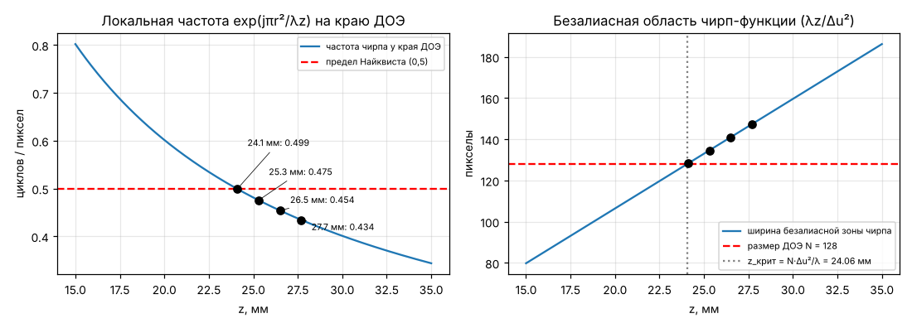
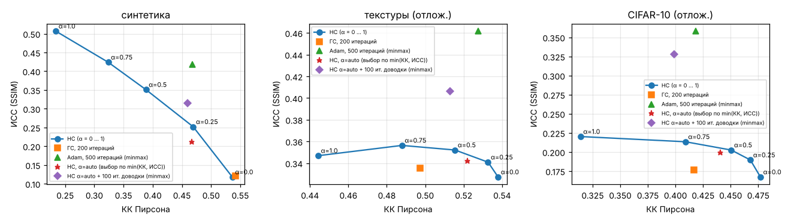
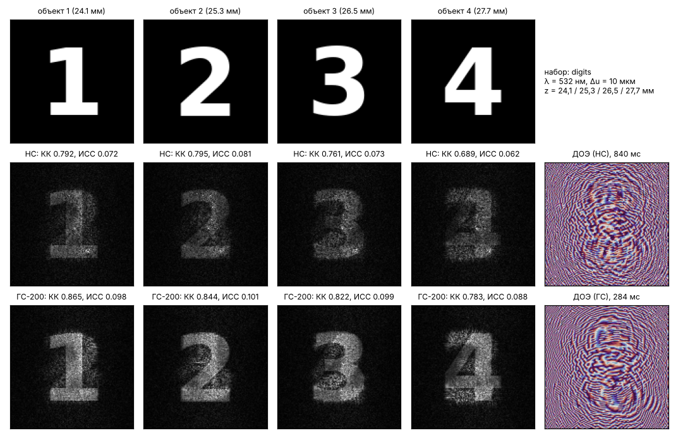
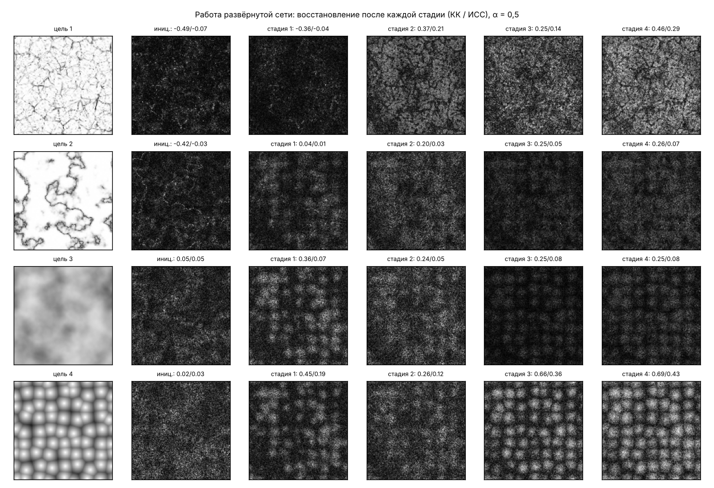

# Отчёт: нейросетевой синтез четырёхплоскостного фазового ДОЭ

Задача: по 4 изображениям 128×128 рассчитать один фазовый ДОЭ 128×128.
Каждое изображение должно восстанавливаться прямым расчётом дифракции Френеля
(одно БПФ) на своём расстоянии: 24,1 / 25,3 / 26,5 / 27,7 мм. Параметры: λ = 532 нм,
пиксел ПВМС 10 мкм. Метрики — КК Пирсона и ИСС (SSIM).

**Правило сравнения** (ответ эксперта в чате хакатона, 06.11): сравниваются амплитуды |K|;
каждое изображение — и исходное, и восстановленное — перед сравнением нормируется на
максимум. Все числа ниже посчитаны по этому правилу и по сохранённым 8-битным PNG:
ДОЭ квантуется в 256 уровней, восстановление делается из квантованного ДОЭ.
ИСС — гауссово окно 11×11 (как MATLAB `ssim`). В `metrics.csv` есть также ИСС 7×7
(как `skimage`) и глобальная формула со слайда 3.

## Главное

1. **Финальная модель** `weights/doe_net.pt` (вариант r8 — s8, дообученная 4 ч на реальных фото и текстурах, раздел 4, этап 4):
   - физически информированная развёрнутая сеть, **8 стадий**, 4,3 млн параметров, на входе стадий — градиент функции потерь;
   - обучение на Kaggle GPU T4 в четыре этапа: 11 000 шагов (g4, 4 стадии), +17 000 шагов дообучения (ftmm), расширение до 8 стадий (s8, новые стадии — копии обученных), затем 10 160 шагов на реальных фото и текстурах с малым шагом 5e-5 (r8);
   - функция потерь — с членом, тянущим вверх худшую из двух метрик;
   - синтез — один прямой проход, ~0,2 с при фиксированном α или ~0,75 с с `--alpha auto` (CPU, 4 потока).
2. **(s8) Чистая сеть с `--alpha auto`** (взвешенный выбор 0,35·КК + 0,65·ИСС, защита от «горячей точки», раздел 7а):

   | Набор | Сеть, КК / ИСС | ГС-200, КК / ИСС |
   |---|---|---|
   | Отложенные текстуры | **0,522 / 0,342** | 0,497 / 0,335 |
   | CIFAR-10 (отлож.) | **0,441 / 0,199** | 0,417 / 0,176 |
   | 56 кейсов expert_runs | 0,499 / 0,300 | — |
   | Ваша четвёрка | **0,484 / 0,283** | 0,402 / 0,267 |
   | Цифры | 0,759 / 0,072 | 0,828 / 0,097 |

   На текстурах и фото сеть за один проход лучше ГС-200 по обеим метрикам. На разреженных объектах (цифры, буквы) честный результат сети близок к ГС: ИСС там ограничен спеклом.
3. **Сеть + 100 итераций доводки** (1,5 с): текстуры 0,513 / 0,406, CIFAR 0,399 / 0,328. Чистая оптимизация Adam (500 итераций, 3,7 с) — 0,528 / 0,462 на текстурах.
4. **Цель «КК и ИСС ≥ 0,85» в этой постановке физически недостижима** (раздел 5). Прямая оптимизация фазы без ограничения по времени на 4 плоскостях даёт не больше:

   | Изображения | КК | ИСС |
   |---|---|---|
   | Текстуры | 0,52 | 0,47 |
   | Цифры | 0,70 | 0,65 |

**Режим по умолчанию в Docker — сеть + 50 итераций доводки** (`--refine 50`, цель доводки
0,35·(1−КК) + 0,65·(1−ИСС), со штрафом за горячую точку), ~0,7 с на комплект:

| Набор | Сеть + 50 ит. | Только сеть (fast) | ГС-200 |
|---|---|---|---|
| Текстуры | **0,542 / 0,392** | 0,531 / 0,353 | 0,497 / 0,335 |
| CIFAR-10 | **0,452 / 0,283** | 0,451 / 0,201 | 0,417 / 0,176 |
| Кейсы expert_runs (56) | **0,512 / 0,348** | 0,507 / 0,309 | — |
| Символы: EMNIST, Fashion-MNIST, Kuzushiji (test) | 0,570 / **0,154** | 0,569 / 0,111 | 0,599 / 0,118 |
| Ваша четвёрка | 0,505 / 0,339 | 0,483 / 0,302 | 0,402 / 0,267 |

Модель r8 (`results/model_comparison_default.json`, `results/model_comparison_nn_only.json`, там же s8).
**Число итераций доводки: качество против времени** (r8, КК / ИСС; CPU, 4 потока):

| Итераций доводки (`--refine`) | Текстуры | CIFAR-10 | 56 кейсов expert_runs | Время на комплект |
|---|---|---|---|---|
| 0 (только сеть) | 0,531 / 0,353 | 0,451 / 0,201 | 0,507 / 0,309 | ~0,22 с |
| **50 (по умолчанию)** | **0,542 / 0,392** | **0,452 / 0,283** | **0,512 / 0,348** | ~0,7 с |
| 100 | 0,551 / 0,410 | 0,452 / 0,306 | 0,517 / 0,363 | ~1,1 с |
| 200 | 0,561 / 0,430 | 0,453 / 0,326 | 0,523 / 0,383 | ~2,0 с |

Больше итераций — выше обе метрики: 200 итераций дают +0,035…0,043 ИСС к режиму по умолчанию,
в 4–5 раз больше, чем 4 часа дообучения s8 → r8. По умолчанию оставлено 50 итераций (~0,7 с):
организаторы учитывают время, а его вес в оценке не объявлен. Режим меняется параметром `--refine`.

Уход от баланса в сторону ИСС почти не помогает: при 50 итерациях вес ИСС 0,5 → 1,0 даёт +0,014 ИСС
и −0,07 КК (среднее по текстурам, CIFAR и кейсам экспертов), поэтому выбран лёгкий наклон 0,65.
На разреженных объектах доводка делает фон темнее, но объекты остаются хорошо видны.

**Нейросеть внутри — режим `--alpha fast`:** один проход при α = 0,5; на разреженных объектах с
горячей точкой — второй проход при α = 0. ИСС для организаторов основной, время тоже учитывается.
На отложенных данных fast почти не уступает выбору из 5 вариантов α, но в 3–4 раза быстрее
(`results/model_comparison_fast.json`):

| Набор | fast (~0,22 с) | auto (~0,75 с) | ГС-200 |
|---|---|---|---|
| Текстуры | 0,517 / 0,342 | 0,522 / 0,342 | 0,497 / 0,335 |
| CIFAR-10 | 0,443 / 0,194 | 0,441 / 0,199 | 0,417 / 0,176 |
| Кейсы expert_runs (56) | 0,499 / 0,294 | 0,499 / 0,300 | — |

## 1. Физическая модель и проверка дискретизации

|K_i(x,y)| = |FFT[exp(jφ) · exp(jπ(u²+v²)/λz_i)]|. Шаг сетки в плоскостях восстановления
λz_i/(NΔu): 10,02 / 10,52 / 11,01 / 11,51 мкм.



Проверка условия дискретизации чирп-функций (к ссылке ResearchGate «Aliasing-free area in
pixel units of the chirp functions»):

- **Локальная частота** exp(jπr²/λz) у края ДОЭ равна (N/2)Δu²/(λz):
  0,499 / 0,475 / 0,454 / 0,434 цикла/пиксел, то есть меньше 0,5.
- **Безалиасная область чирпа** λz/Δu² ≥ N = 128 выполняется при
  z ≥ z_крит = NΔu²/λ = **24,06 мм**.

Минимальное расстояние задачи 24,1 мм стоит ровно на этой границе, поэтому формула с одним БПФ
корректна во всех четырёх плоскостях.

Физика сверена с независимой реализацией: ДОЭ из присланных `expert_runs`, восстановленные
нашей моделью, совпадают с их полями с корреляцией 0,99999999998.

## 2. Метод

Развёрнутая сеть: U-Net-инициализатор задаёт фазы в плоскостях изображений. Затем
обратное распространение Френеля и 4 обучаемые стадии. В каждой стадии U-Net получает:
- цели;
- текущие восстановления;
- невязку;
- градиент потерь ∂L/∂|F_i|;
- α.

Стадия выдаёт перевзвешивание амплитуд, маску свободы амплитуды и поправку фазы, после
чего поле возвращается на ДОЭ. Подробности — в [README.md](README.md) и `doe/model.py`.

**Обучение без учителя**:

L = (1−α)(1−КК) + α(1−ИСС) + 0,1·СКО + 0,5·(1 − softmin(КК, ИСС)),  α ~ U[0,1].

ИСС считается так же, как его посчитает жюри: оба изображения нормируются на максимум.

**Синтез с `--alpha auto`**:
- сеть за один батч-проход считает ДОЭ при α = 0; 0,25; 0,5; 0,75; 1;
- по физической модели выбирается ДОЭ с максимальным min(КК, ИСС) (`--select min`) или с максимальной суммой (`--select sum`).

Цели на этапе синтеза известны — это входные изображения, — поэтому выбор честный: ни
оптимизации, ни подгонки результата.

## 3. Данные

| Источник | Доля банка | Использование |
|---|---|---|
| Процедурная синтетика (символы латиницы и кириллицы, фигуры, точки, решётки, 1/f-шум) | 35 % | обучение |
| Ваш пак SBS Noise Textures 128×128 (262 шт., CC0) | 15 % | 226 — обучение, 36 (№ 3 и 7 каждой категории) — контроль |
| Полный пак [700 noise textures](https://opengameart.org/content/700-noise-textures), версия 512×512 | 30 % | фрагменты 128…512 px, то же разбиение |
| CIFAR-10 в оттенках серого (как в [Jemuna/…TensorFlow](https://github.com/Jemuna/Image-Classification-Using-Deep-Learning-in-TensorFlow)) | 20 % | 9000 — обучение, 1000 — контроль; загружен с Kaggle в CSV, без `pickle` |

Эксперт подтвердил, что можно использовать любой открытый датасет.

## 4. Обучение (Kaggle, GPU T4 ×2)

**Этап 1 — с нуля, 3 ч** (контроль при α = 0,5, КК / ИСС):

| Вариант | Стадии | Градиентные признаки | Шагов | Score* | Синтетика | Текстуры | CIFAR |
|---|---|---|---|---|---|---|---|
| u4 | 4 | нет | 12 110 | 0,672 | 0,514 / 0,095 | 0,489 / 0,300 | 0,447 / 0,172 |
| u6 | 6 | нет | 13 039 | 0,667 | 0,518 / 0,097 | 0,477 / 0,293 | 0,445 / 0,172 |
| **g4** | 4 | **да** | 11 000 | **0,722** | 0,333 / 0,376 | 0,503 / 0,319 | 0,446 / 0,189 |
| g6 | 6 | да | 12 000 | 0,688 | 0,520 / 0,101 | 0,492 / 0,314 | 0,444 / 0,194 |

\* Score — среднее (КК + ИСС) при α = 0,5 по трём контрольным группам.

**Этап 2 — дообучение от g4, ≤ 5 ч (лимит по времени на Kaggle).** Банк — 120 000 изображений.
Сравнение по официальному правилу, `--alpha auto`, 24 четвёрки на группу и 56 кейсов экспертов
(`results/model_comparison.json`):

| Модель | Функция потерь | Шагов | Текстуры | CIFAR | Кейсы экспертов | min-score | sum-score |
|---|---|---|---|---|---|---|---|
| g4 | max | 11 000 | 0,443 / 0,319 | 0,322 / 0,209 | 0,396 / 0,292 | 0,273 | 0,660 |
| ft | max | +17 003 | 0,446 / 0,333 | 0,323 / 0,218 | 0,403 / 0,303 | 0,285 | 0,676 |
| **ftmm** | max + softmin | +17 020 | **0,456 / 0,334** | 0,324 / 0,217 | **0,414 / 0,302** | 0,284 | **0,682** |
| rms | rms | +14 222 | 0,473 / 0,294 | 0,387 / 0,201 | 0,443 / 0,262 | 0,253 | 0,687 |
| rms_mm | rms + softmin | +13 957 | 0,471 / 0,289 | 0,381 / 0,200 | 0,445 / 0,260 | 0,250 | 0,682 |

Выбрана ftmm. Варианты под RMS-нормировку (см. раздел 8) по официальному правилу
дают выше КК, но ниже ИСС.

**Узкое место обучения.** Профилировщик на T4: ~60 % времени GPU уходило на копирования и
поэлементные операции, в основном из-за кругового паддинга свёрток (он копирует каждый вход
свёртки); свёртки занимали ~13 %. С нулевым паддингом и fused-AdamW 8 стадий обучаются с той же
скоростью шага (~0,94 с), что раньше 4.

**Этап 3 — 8 стадий, нулевой паддинг, ≤ 5 ч.** Сеть ftmm расширена до 8 стадий: новые стадии —
копии обученных. Сравнение по тому же протоколу, теперь с выбором α по 0,35·КК + 0,65·ИСС и
защитой от горячей точки (раздел 7а):

| Модель | Шагов | Текстуры | CIFAR | Кейсы экспертов | Ваша четвёрка |
|---|---|---|---|---|---|
| ftmm (4 стадии) | — | 0,502 / 0,319 | 0,442 / 0,187 | 0,483 / 0,284 | 0,465 / 0,262 |
| **s8** (8 стадий, лучший чекпойнт) | 1 000 | **0,522 / 0,342** | 0,441 / 0,199 | **0,499 / 0,300** | 0,484 / 0,283 |
| s8hi (lr 3e-4) | 1 000 | 0,516 / 0,343 | 0,445 / 0,200 | 0,496 / 0,302 | 0,473 / 0,287 |
| s8, конец обучения | 16 207 | 0,515 / 0,331 | 0,436 / 0,205 | 0,493 / 0,295 | 0,463 / 0,269 |

Выбрана s8. Прирост дали сами дополнительные стадии: лучший результат — сразу после
расширения. Дальше нормы градиента выросли до 10⁴–10⁵ (нестабильность при смене паддинга),
метрики просели и к концу почти восстановились; вариант с lr 3e-4 разошёлся. Обучение с меньшим
шагом и разогревом новых стадий — следующий шаг.

**Этап 4 — r8: реальные данные, малый шаг, ≤ 5 ч.** s8 дообучена на смеси: синтетика 20 %,
текстуры 30 %, реальные фото 25 % (Imagenette, BSDS500), реальные текстуры DTD 25 %; контроль —
также на фото Kodak. Шаг 5e-5, штраф за горячую точку, член minmax. В этот раз обучение
устойчиво: метрики росли до конца (10 160 шагов), поэтому взят последний чекпойнт.
Попарное сравнение с s8 в режиме по умолчанию на тех же комплектах:

| Набор | Δ КК | Δ ИСС | ИСС лучше |
|---|---|---|---|
| Текстуры (24) | +0,007 ± 0,001 | +0,007 ± 0,001 | в 100 % комплектов |
| CIFAR-10 (24) | +0,002 ± 0,002 | +0,011 ± 0,002 | в 92 % |
| Кейсы expert_runs (56) | +0,003 ± 0,001 | +0,006 ± 0,001 | в 86 % |
| Символы (24) | +0,002 ± 0,002 | −0,002 ± 0,003 | в 67 % |
| Синтетика (24) | +0,006 ± 0,003 | −0,012 ± 0,008 | в 67 % |

Чистая сеть (без доводки) выросла сильнее: текстуры 0,517 / 0,342 → 0,531 / 0,353, кейсы
экспертов 0,499 / 0,294 → 0,507 / 0,309. Вариант той же схемы с fp16 (r8amp) чуть хуже.

**Символы и силуэты.** Отдельно проверены отложенные сцены из test-частей EMNIST,
Fashion-MNIST и Kuzushiji-49 (один крупный символ, россыпь или строки): r8 + 50 ит. —
0,570 / 0,154, ГС-200 — 0,599 / 0,118. Это самая трудная группа: изображения разных плоскостей
просвечивают друг в друга, и на чёрном фоне ИСС наказывает любой паразитный свет. Более
высокий ИСС (0,37–0,53) здесь получается только «горячей точкой» — экран почти чёрный, символ не
виден (раздел 7а); защита режима по умолчанию такие решения отбрасывает. Загрузчик символьных
датасетов (EMNIST, Fashion-MNIST, Kuzushiji, CASIA-HWDB) и лиц LFW добавлен в обучение
(`--mix` с 7-й долей); дообучение на них не завершено — закончилась недельная GPU-квота Kaggle.


## 5. Цель 0,85 / 0,85: потолок качества

Прямая оптимизация фазы ДОЭ для первых P плоскостей: 3000 итераций Adam, цель — максимум
min(КК, ИСС), лучший из нескольких стартов. Скрипт — `scripts/capacity_experiment.py`,
данные — `results/capacity.json`.

| Набор | 1 плоскость | 2 плоскости | **4 плоскости (задача)** |
|---|---|---|---|
| Ваши текстуры | 0,999 / 0,994 | 0,829 / 0,817 | **0,523 / 0,468** |
| Цифры (старт от ГС) | 0,830 / 0,762 | 0,755 / 0,700 | **0,695 / 0,654** |
| Буквы (старт от ГС) | 0,831 / 0,570 | 0,663 / 0,387 | **0,646 / 0,592** |

Это верхняя оценка для любой сети: сеть тоже выдаёт фазу ДОЭ и не может превзойти
оптимизацию той же фазы. Причины физические:
- плоскости разнесены на 1,2 мм при глубине фокуса λ/NA² ≈ 0,85 мм, поэтому в каждой
  плоскости присутствует расфокусированный свет трёх других изображений;
- один фазовый экран — это 16 384 степени свободы против 4×16 384 требуемых амплитуд.

## 6. Сравнение методов (контроль, по 24 четвёрки на группу)

| Метод | Синтетика | Текстуры (отлож.) | CIFAR-10 (отлож.) | Время на ДОЭ, мс |
|---|---|---|---|---|
| НС, α = 0 (макс. КК) | 0,514 / 0,116 | 0,537 / 0,319 | 0,463 / 0,168 | 205 |
| НС, α = 0,5 | 0,373 / 0,332 | 0,516 / 0,344 | 0,437 / 0,203 | 200 |
| НС, α = 1 (макс. ИСС) | 0,227 / 0,492 | 0,440 / 0,342 | 0,302 / 0,219 | 216 |
| **НС, α = auto** (взвешенный выбор, защита) | 0,467 / 0,212 | **0,522 / 0,342** | **0,441 / 0,199** | 757 |
| **НС α = auto + 100 итераций доводки** | 0,460 / 0,315 | 0,513 / 0,406 | 0,399 / 0,328 | 1539 |
| ГС, 50 итераций | 0,532 / 0,112 | 0,461 / 0,303 | 0,388 / 0,156 | 66 |
| ГС, 200 итераций | 0,542 / 0,120 | 0,497 / 0,335 | 0,417 / 0,176 | 272 |
| Adam, 500 итераций (minmax) | 0,468 / 0,418 | 0,528 / 0,462 | 0,419 / 0,358 | 3681 |

В ячейках — КК / ИСС. CPU, 4 потока; время без ввода-вывода. Модель s8 (8 стадий).
Строки с фиксированным α > 0 на синтетике содержат эффект горячей точки (раздел 7а);
режим α = auto его отбрасывает. На графике ниже точка α = auto подписана старым критерием выбора.



## 7. Контрольные наборы (НС, α = auto с защитой от горячей точки, один проход)

| Набор | КК | ИСС | ИСС 7×7 | ГС-200: КК / ИСС | выбранное α |
|---|---|---|---|---|---|
| Ваша четвёрка* | 0,484 | 0,283 | 0,307 | 0,402 / 0,267 | auto |
| textures_a (отлож.) | 0,455 | 0,245 | 0,267 | 0,322 / 0,200 | auto |
| textures_b (отлож.) | 0,574 | 0,423 | 0,427 | 0,599 / 0,422 | auto |
| textures_c (отлож.) | 0,522 | 0,359 | 0,366 | 0,578 / 0,350 | auto |
| natural (`skimage.data`) | 0,499 | 0,262 | 0,263 | 0,512 / 0,247 | auto |
| digits | 0,759 | 0,072 | 0,072 | 0,828 / 0,097 | auto |
| letters | 0,777 | 0,066 | 0,067 | 0,823 / 0,084 | auto |
| words | 0,734 | 0,124 | 0,128 | 0,786 / 0,212 | auto |
| shapes | 0,693 | 0,070 | 0,070 | 0,732 / 0,088 | auto |

\* Эти четыре текстуры входили в обучающую часть, поэтому для оценки обобщения
смотрите `textures_a/b/c`.

### 7а. «Горячая точка»: лазейка метрики, которую мы закрыли

При нормировке на максимум сеть на разреженных объектах научилась собирать часть света
в один пиксель. Максимум задаёт этот пиксель, весь кадр становится почти чёрным
(средняя яркость 3–5 из 255), чёрный фон «совпадает» с фоном цели, и ИСС растёт до 0,5–0,7.
Но объект на таком восстановлении почти не виден.

Поэтому `--alpha auto` по умолчанию отбрасывает варианты, у которых 99-й перцентиль
восстановления ниже 30 % максимума (`--hotspot-guard 0.3`; `0` отключает защиту).
На текстурах и фото защита ничего не меняет, горячей точки там нет. На разреженных объектах
остаётся α = 0, и сеть ведёт себя как ГС. В таблицах раздела 6 режимы НС с α > 0 на
синтетике ещё содержат этот эффект.

ДОЭ, восстановления, `metrics.csv/json` и `preview.png` для каждого набора лежат в
`results/<набор>/`.





## 8. Присланные `expert_runs`: проверка

- **56 кейсов** — текстуры семейств Streak, Perlin, Milky, Turbulence.
- **Метрики честные:** пересчёт по их PNG совпал.
- **Физика та же:** корреляция полей 0,99999999998.
- **Но нормировка другая:** RMS восстановления приравнен RMS цели, с насыщением на 255 (`--norm rms` воспроизводит их PNG с точностью ±1).

| Решения на тех же 56 кейсах | По их правилу (rms) | По официальному правилу (max) |
|---|---|---|
| Их ДОЭ | 0,682 / 0,451 | 0,571 / 0,254 |
| Наша НС (s8, α = auto) | — | 0,499 / 0,300 |
| Наша НС r8 + 50 ит. доводки (по умолчанию) | — | 0,512 / 0,348 |

При правиле RMS горячие спекл-пики насыщаются, а ИСС и КК растут. По официальному правилу
(нормировка на максимум) их ДОЭ дают 0,571 / 0,254, наша сеть — 0,499 / 0,300 за один проход
и 0,512 / 0,348 в режиме по умолчанию: у них выше КК, у нас заметно выше ИСС (основная метрика).
Поддержка правила RMS в коде оставлена (`--norm rms`, `--ssim-norm rms`) на случай, если
организаторы его примут.

## 9. Сравнение с реализацией FresnelNet в `main`

| | FresnelNet (после дообучения) | `unrolled/` (s8) |
|---|---|---|
| Ваша четвёрка, КК / ИСС 7×7 | 0,311 / 0,219 | **0,484 / 0,307** |
| Обучение | CPU, 468 с, width 12 | GPU T4, ~12 ч в три этапа, 4,3 млн параметров, 8 стадий |
| Данные | 140 текстур + процедурные фигуры | синтетика + 700 noise textures (512 px) + CIFAR-10 |
| Управление компромиссом КК/ИСС | нет | α, `--alpha auto`, `--select min/sum` |

Из `main` стоит перенять разбиение текстур по семействам, независимую квадратуру
Френеля в тестах и SHA256-манифесты.

## 10. Ограничения и что дальше

1. **Стабилизировать обучение глубокой сети:** меньший шаг, разогрев новых стадий, штраф за горячие точки в функции потерь. Сейчас прирост дало само расширение до 8 стадий, а не долгое дообучение.
2. **Если допустимы 1–2 с на ДОЭ**, использовать режим «сеть + доводка» (`--refine 100`): +0,06 к ИСС на текстурах.
3. **Узнать у организаторов** способ объединения КК и ИСС в итоговую оценку и окно SSIM, затем выставить `--select` и окно в функции потерь.
4. **Разбиение текстур по номерам, а не по семействам:** оценка обобщения на новые семейства может быть ниже.
5. **Это численное моделирование:** эксперимент на физическом ПВМС не проводился.

## Воспроизведение

```bash
cd unrolled
python synthesize.py --input-dir examples/noise_quartet --out results/my_run           # НС, α=auto
python synthesize.py --input-dir examples/noise_quartet --refine 100 --out results/r    # НС + доводка
python scripts/compare_models.py --weights s8=weights/doe_net_s8.pt ftmm=weights/doe_net_ftmm.pt g4=weights/doe_net_g4.pt
python scripts/compare_models.py --weights r8=weights/doe_net.pt s8=weights/doe_net_s8.pt --alpha fast --refine 50 \
    --expert-dir path/to/expert_runs --glyph-root path/to/glyph_test_files
python scripts/make_report.py --weights weights/doe_net_s8.pt --log weights/train_log_s8.jsonl
python scripts/kaggle_run.py push --slug doe-nn-s8 --dataset fiskarik/doe-nn-data --require-gpu --timeout 18000 \
    --job "s8:--init weights/doe_net_ftmm.pt --grad-feat --pad zeros --stages 8 --hours 4.6 --batch 24 --amp --bank 120000 --lr 2e-4 --w-minmax 0.5"
```
